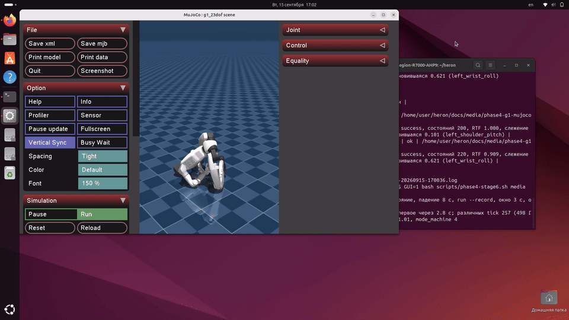
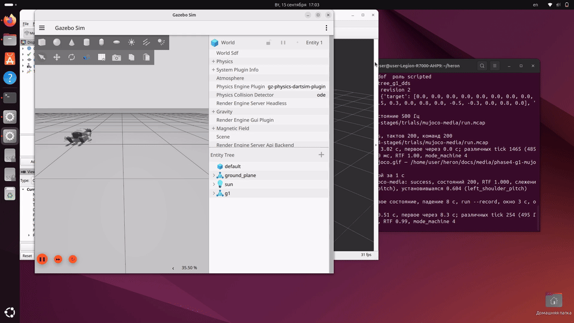
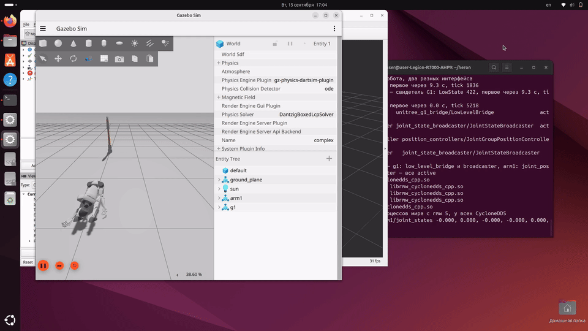

# Журнал изменений

Записи появляются по завершении фазы из раздела 14 архитектуры. Формат: что
изменилось для пользователя платформы, что этим доказано и что осталось.

## [0.4.0] — 2026-09-15 — фаза 4: второй робот с принципиально иным интерфейсом

Робот, которым правит не стек управления платформы, а собственный протокол производителя. Гуманоид G1
командуется законом привода в каждой команде DDS — `q*`, `kp`, `kd` в 23 из 29 слотов моторов — и входит в
платформу пакетом, устроенным как пакет производителя: адаптер и двойники, точки входа, только публичный API.
Ни строки ядра под него. Один и тот же адаптер без изменения кода ведёт G1 в двойнике MuJoCo производителя и
в Gazebo через мост пакета, а в сцене комплекса — рядом с манипулятором на `ros2_control`.

Главное в фазе — не G1. Она доказывает абстракцию для любого робота, чей производитель дал адаптер и
двойник: встроенный путь `ros2_control` стал таким же двойником той же группы, и протокол двойника принял
обе реализации.

### Добавлено

- **Пятая точка расширения — сторона двойника** (ADR-0021, ADR-0024). Пакет робота поставляет адаптер на все
  среды и двойника для пары «адаптер, бэкенд»; двойник объявляет род — «владеет физикой» или «мост» — и
  требования. Генераторы Gazebo не знают `ros2_control` по имени. `PUBLIC_MODULES` и тест: пакеты в
  `examples/plugins` импортируют из платформы только их.
- **Требования к окружению** (ADR-0025): значения `Requirement` у адаптера и двойника; `env check` проверяет
  сцену целиком, `sim run` — двойников до запуска, `run` — адаптер до подключения.
- **Бэкенд `mujoco`** (ADR-0030) запускает двойника и сам MuJoCo не импортирует. **MJCF — второе описание
  робота** (ADR-0031): правила `mjcf.*` и предупреждение о расхождении двух описаний.
- **Коэффициенты привода — нормативные поля действия** (ADR-0019): `kp` и `kd` по суставам; старые
  идентификаторы контрактов не меняются.
- **Пакет `unitree-g1`** в `examples/plugins/unitree_g1`: DDS-адаптер со слотами моторов, сверкой тела по
  `mode_machine`, демпфирующим остановом и каналом CycloneDDS 0.10.2 (ADR-0022, ADR-0027–0029); двойник MuJoCo —
  `unitree_mujoco` производителя без правок (ADR-0023); двойник Gazebo — контроллер моста `LowLevelBridge` на C++
  (ADR-0033) и окружение DDS сцены (ADR-0034).
- **Запись прогона** — `run --record <файл>` (ADR-0038): исполнитель по ходу прогона пишет в MCAP каждое
  прочитанное состояние и каждую принятую команду со временем мира и часами исполнителя, контракт и итог.
- **`run` присоединяется к миру в его окружении** (ADR-0039); переменная процесса с другим значением — отказ.
- **Сцены** `humanoid.yaml`, `humanoid_mujoco.yaml` (одна цель в обоих мирах) и `complex.yaml` (два робота).
- **Правила валидатора** фазы 4: `urdf.free_base_uncontrolled` (ADR-0018), `mjcf.*`, `twin.*`, `env.*` — всего
  кодов стало 52.
- **Руководство:** раздел «Если производитель дал адаптер и двойник». Эксперимент 0001 с числами.

### Изменено

- `sim run` берёт бэкенд из группы `sim_backends` по `world.backend`.
- Отказ адаптера в команде — `CommandRefusedError`; исполнитель сначала останавливает робота (ADR-0026).
- Навык, строящий движение от измеренной позы, начинает с её проекции в рамку профиля (ADR-0032).
- Мир останавливается как у терминала: SIGINT группе процессов в своей сессии, ожидание опустения группы
  (ADR-0035–0037).
- Порождённая копия описания ссылается на меши абсолютными `file://` (ADR-0017).
- `run` сообщает ошибку импорта при подключении отказом, а не трассировкой.
- Группы зависимостей `record` (`mcap`) и `ros2` (`numpy` для сообщений ROS 2 в окружении Python).

### Что доказано

Критерии фазы из плана — на Linux-машине:

- `move_joints` двигает G1 в двойнике MuJoCo производителя через DDS-адаптер; тот же навык и тот же адаптер без
  изменения кода — в Gazebo через мост. Связь в профиле записана одна на оба мира.
- **Связь одинакова в обоих мирах** (эксперимент 0001): период исполнителя 20.1 мс, ни одного несвежего чтения и
  срабатывания сторожевого таймера в восьми попытках. Всё, чем миры различаются, — по другую сторону связи.
- DDS-адаптер проходит общий контрактный набор тестов адаптеров вместе с `dummy` и `ros2_control`.
- Пакет робота — отдельный дистрибутив, найден через точки входа, импортирует только публичный API; это держит тест.
- Бэкенд MuJoCo общий и не знает протокола ни одного робота; `ros2_control` — двойник той же группы.
- **Комплекс:** манипулятор через `ros2_control` и G1 через DDS в одном мире Gazebo, два менеджера контроллеров,
  один владелец физики (ADR-0002). Связи не пересекаются: свидетель насчитал 411 и 327 команд на топике G1 во
  время его навыка и ни одной во время навыка манипулятора.
- Вендорского имени в ядре нет; ядро ставится без вендорских зависимостей.

### Чему научил запуск

Почти каждый отказ фазы оказался одной формы: **звено, которое не было проверено, потому что проверка не могла
провалиться.**

- Остановка мира Gazebo потребовала трёх прогонов на три звена: `ros2 launch` на SIGTERM бросает детей
  (ADR-0035); SIGINT, унаследованный фоновым заданием игнорируемым, CPython не слушает (ADR-0036); оболочка
  `/bin/sh -c` перед `gz sim` сигнал не передаёт (ADR-0037). Тест первого исправления проверял обещание
  платформы процессу, а не поведение процесса. Различили причины подробности отказа — «вышел через 1 с», «16 с»,
  «6 с» — а не догадки.
- Навык отказывал на упавшем роботе, и дефект виден был с первого прогона гуманоида: отказ адаптера признали
  верной работой и исправили следствие. Неверной была команда навыка — поза за пределами рамки (ADR-0032).
- `numpy` не был объявлен нигде: связь ROS 2 получала его зависимостью MuJoCo и работала по совпадению, пока
  синхронизация без этой группы его не удалила. Проверка требований находит модули без импорта и такое не видит.
- Проверки, выбранные до данных, трижды не выдержали их: «G1 неподвижен» не различал дрейф упавшего робота и
  чужие команды, «возраст состояния» предполагал постоянную скорость мира, окно «до» сравнивало стоящего робота с
  упавшим. Взамен — проверки, которые сначала показывают, что могут сработать: свидетель считает команды G1
  во время его навыка, прежде чем считать их во время чужого.

Отсюда правило на следующие фазы: **проверка, которая не может провалиться при дефекте, — не проверка;
показать, что она срабатывает, — часть её написания.**

### Что осталось

- **Кисти G1 в Gazebo** расходятся с эталоном систематически (0.55–0.57 рад в каждой попытке). Гипотеза расчётом —
  дискретный закон моста неустойчив на звене без инерции ротора (`kd·Δt/I` ≈ 10 против 0.1 у эталона); проверка по
  разбросу позиции и моменту кистей, исправление — отдельное решение.
- Законы привода двух двойников при упавшем роботе не сравнить: нужно начальное условие без контакта — решение.
- Скриптовая проверка движения G1 в комплексе не пройдена по вине скрипта; этап закрыт по свидетелю команд и записи
  прогона, исправленный скрипт не прогонялся.
- Задачи CI в сессии закрытия не проверены — к результатам запусков не было доступа.
- Воспроизведение по записи (роль `replay`, `trajectory import`) не написано; `rmw_cyclonedds_cpp` для процесса
  `run` с `ros2_control` не объявлен требованием адаптера (ADR-0039); домен DDS на робота в одном мире отложен
  (ADR-0034).
- Уровень доступа `partial` и канал `rt/arm_sdk` — фазы 5–7; настоящий G1 — фаза 7; координатор — фаза 8.
- Версия платформы по-прежнему записана дважды — в `pyproject.toml` и в `__init__.py`.

## [0.3.0] — 2026-09-12 — фаза 3: навык двигает робота

Появилось звено, которого не хватало с первой фазы: связь с роботом, которым
правит `ros2_control`. Профиль объявлял её три фазы подряд, а валидатор три фазы
подряд писал `adapter.plugin_not_installed`. Вместе со связью появились навык,
который двигает, и исполнитель, который ведёт темп и следит за состоянием.

Манипулятор из профиля поехал в Gazebo по команде навыка на Linux-машине — то,
чего фаза требовала. Запись открывалась заранее и до прогона версии не имела:
фаза 2 была описана до запуска, и описание пришлось потом править.

### Добавлено

- **`ControlAdapter` поверх `ros2_control`** — читает `/<робот>/joint_states`,
  пишет в топик контроллера. Порядок суставов восстанавливается по именам, а не
  по позициям в массиве: сообщение состояния не обязано приходить в порядке
  контракта, и прочитать его позиционно значит получить робота, у которого
  второй сустав держит угол третьего. Сустав, объявленный контрактом и не
  пришедший в состоянии, — ошибка, а не ноль. Суставы сверх контракта читаются и
  попадают в `extra` (ADR-0012 на другом конце связи).
- **Имена управляющего слоя выводятся один раз** (`ros2/names.py`) и читаются и
  генератором, и адаптером. Топики ведомых роботов пишутся в `manifest.json`:
  то, что прогон будет искать, лежит на диске до прогона (ADR-0014).
- **Транспорт внедряется** — адаптер отдаёт ему топик, тип сообщения и обычные
  значения, а сам объектов ROS 2 не строит. Что прогон опубликует, проверяемо до
  публикации — та же позиция, что ADR-0011 занял для процессов. Импорт ROS 2
  происходит внутри `connect`, и платформа целиком работает там, где ROS 2 нет.
- **Навык `move_joints`** — ведёт суставы к объявленной позе по временно́му
  разгону. Разгон делает навык: групповой контроллер позиций передаёт команду
  прямо в интерфейс сустава, поэтому одна команда в цель означает «окажись там
  немедленно». Цель вне лимитов или неверной ширины отклоняется до первой
  команды, а не посреди движения.
- **Исполнитель** — темп из `command_rate_hz`, период считается от начала такта;
  сторожевой таймер выводится из `state_rate_hz` и полем не объявляется.
  Сработал — сначала останов робота, потом отчёт (ADR-0015).
- **CLI**: `run` с `--robot`, `--skill`, `--target`, `--goal` и `--dry-run`.
  Мир поднимает `sim run`, задачу исполняет `run`: мир и контейнер робота —
  разные единицы развёртывания.

### Изменено

- `manifest.json` перешёл на версию 2: у каждого ведомого робота появился блок
  `control`.
- Генерируемая конфигурация задаёт `use_local_topics: false` явно. Умолчание —
  факт о чужом исходнике; значение — то, что объявляет платформа.
- Из `examples/robots/arm6.yaml` убрано поле `params: {controller: ...}`. Оно
  никем не читалось и **уже разошлось** с генератором: объявляло
  `joint_trajectory_controller` там, где для потокового режима выводится
  `joint_position_controller`. Контроллер выводится из режима и типа действия,
  то есть уже описан контрактом.

### Что доказано

- Общий контрактный набор тестов адаптеров принял вторую реализацию. Фаза 1
  записала, что это ничего не стоит; стоило ровно двух строк и фабрики.
- Контракт хватает не только для порождения сред, но и для управления: тип
  действия задаёт топик и сообщение, порядок суставов — перестановку состояния,
  частоты — темп цикла и порог таймера. Ни одного поля добавлять не пришлось.
- Платформа, включая адаптер `ros2_control`, импортируется и проходит все тесты
  на машине без ROS 2. Проверяется подпроцессом, а не доверием.
- Пакеты, которые импортирует транспорт, объявлены и сверены со скриптом фазы 0
  с двух сторон — правило ADR-0013, перенесённое с запуска на адаптер.

### Чему научил запуск

Два отказа, оба на стыке платформы с окружением, и оба одной формы — величина
описана дважды либо взята не оттуда, где достоверна.

Первый: окружение исполнения создавалось на Python 3.11, потому что скрипт фазы 0
переиспользовал константу, заведённую для колёс Isaac Sim. ROS 2 Jazzy собран под
3.12, `rclpy` — скомпилированное расширение, и адаптер не импортировался вовсе.
Версия теперь читается из самой установки ROS 2.

Второй: первое чтение состояния ждало `DEFAULT_POLL_S` — 0.1 с, длительность
одного такта. Контроллеры были активны, а сообщения не приходили: подписка,
созданная мгновение назад, ещё не сопоставлена с издателем. «Сколько ждать
сообщение в такте» и «сколько ждать, пока связь появится» оказались разными
величинами (ADR-0016). Заодно нашёлся одноразовый исполнитель на каждый опрос,
терявший сообщения между пересборками набора ожидания, — дефект с тем же внешним
проявлением, который «увеличением таймаута» остался бы незамеченным.

Отсюда правило, которое дальше стоит применять до написания кода, а не после
отказа: если два употребления одной величины отвечают по-разному на вопрос
«откуда она взялась», это две величины.

### Что осталось

- **Гифки нет.** Ни для фазы 2, ни для фазы 3: `docs/media/` пуст. Раздел 18
  требует складывать медиа в момент получения, и переснять первый запуск
  невозможно. Это долг перед пояснительной запиской, а не перед кодом.
- Числа прогона не записаны: сколько тактов, за какое время, с каким
  расхождением команды и состояния. `docs/experiments/` пуст.
- Запись прогона. ADR-0003 задаёт формат, но состав записи — всё, что движется,
  а не только `joint_order` — тянет на отдельное решение.
- Порог сторожевого таймера и срок установления связи не измерены: обе величины
  — первые разумные значения, а не результат наблюдения.
- Версия платформы записана дважды — в `pyproject.toml` и в `__init__.py`.
  Нарушение сквозного принципа проекта, замеченное при закрытии этой фазы.
- Порог ADR-0005 не измерен: `scripts/phase0.sh` по-прежнему не прогонялся.

## [0.2.0] — 2026-09-12 — фаза 2: среды из профиля

Профиль перестал быть только данными для проверок: из него порождаются среды.
Манипулятор из профиля и сценария собирается в мир Gazebo с визуализацией в
RViz — и сцена поднялась на целевой Linux-машине. Фаза закрыта пятым прогоном;
первые четыре описаны в журнале и в списке ниже.

### Добавлено

- **Генераторы сред** — из профиля и сценария порождаются блок `ros2_control`,
  конфигурация контроллеров, мир SDF, файл запуска ROS 2 в XML, конфигурация
  RViz и манифест набора. Кинематику платформа не сочиняет: `description.urdf`
  и заданный сценарием мир — вход, и генератор их не перезаписывает (ADR-0009).
- **Сверка описания с профилем** — одиннадцать правил `urdf.*`: пропавший или
  переименованный сустав, сустав, заваренный в модели, лимит профиля шире
  предела модели, скорость выше модельной, недостающий меш, нерасширенный
  шаблон. Сравнение идёт с переводом единиц: URDF по спецификации в радианах,
  а контракт может объявлять градусы.
- **Детерминированная генерация и `gen --check`** — тот же вход даёт тот же
  выход, поэтому «артефакты отстали от профиля» стало проверяемым фактом. В
  шапке каждого файла записан `contract_id`, при котором он порождён (ADR-0010).
- **`SimBackend` для Gazebo** — собирает мир и запускает сцену. Сцену, не
  прошедшую валидатор, не строит вовсе (инвариант 6). Процессы запускаются
  через внедряемый запускатель, поэтому команды запуска проверяемы до запуска
  (ADR-0011).
- **CLI**: `gen` с `--check` и `--backend`, `sim run` с `--dry-run`,
  `--headless` и `--no-rviz`.
- **Заготовка нового робота** дополнена скелетом описания: без него робот из
  заготовки не встаёт ни в один мир.
- **Опорные описания** шестистепенного манипулятора и манипулятора по сетевому
  API, сценарий с двумя роботами из одного профиля, второй из которых —
  препятствие.

### Что доказано

- Контракт полностью выражается в интерфейсах управления: тип действия — в
  командный интерфейс, наблюдения — в интерфейсы состояния, порядок суставов —
  в состав контроллера, частота состояния — в частоту менеджера, режим
  управления — в класс контроллера. Ни одного поля добавлять не пришлось.
- Валидатор ловит до запуска расхождение профиля и модели робота: переименование
  сустава, заваренный сустав, лимит шире физического предела.
- Два экземпляра одного профиля в одной сцене не пересекаются: пространства
  имён, префиксы систем отсчёта и каталоги артефактов строятся от идентификатора
  в сценарии.
- Порождение сред не требует ни симулятора, ни ROS 2: оно проверяется в той же
  задаче CI, что и установка ядра без вендорских зависимостей.

### Чему научил запуск

Пять прогонов, четыре отказа, и все четыре одной формы: **артефакт корректен,
внешний потребитель читает его иначе.** URDF, прочитанный launch-фронтендом как
YAML. Файл параметров, адресованный `controller_manager` вместо
`/arm1/controller_manager`. Дерево преобразований, неполное из-за суставов, чьё
состояние никто не читал. Узел из пакета, которого нет в окружении, — и сцена не
деградировала, а не поднялась целиком.

Каждый раз проверка «состав порождённого» проходила, а «контракт чтения» не
проверялся ничем. Три из четырёх случаев теперь закрыты механическими проверками
(ADR-0012, ADR-0013 и объявление типа параметра), и это главный итог фазы:
граница проверяемости без запуска, названная в ADR-0011, сдвигается не
рассуждением, а тестом, который знает про внешнего потребителя.

### Что осталось

- `compose.yaml` и раскладка Foxglove не порождаются осознанно: у первого нет
  команды запуска до появления `Executor` (фаза 8), у второй нет данных до
  первого движения (фаза 3).
- USD и конфигурация среды обучения — фаза 6.
- Порог ADR-0005 не измерен: `scripts/phase0.sh` по-прежнему не прогонялся.

## [0.1.0] — 2026-09-12 — фаза 1: каркас

Первая версия, которую можно поставить и запустить. Симулятора, обучения и
железа в ней нет: цепочка «профиль → валидатор → навык → адаптер» работает на
`dummy`-двойнике.

### Добавлено

- **Профиль робота** — декларативное описание в YAML со строгой схемой:
  контракт, возможности, режим управления, уровни доступа, лимиты, адаптеры.
  Неизвестное поле отвергается, а не игнорируется.
- **Реестр возможностей** — закрытый список ключей `<домен>.<аспект>`;
  возможности сторонних роботов — в домене `x_` (ADR-0001).
- **Идентичность контракта** — `contract_id` вычисляется из нормативных полей;
  совместимость определяется равенством идентификаторов, а расхождение
  показывается по полям (ADR-0004). Каноническая форма зафиксирована и покрыта
  золотым тестом (ADR-0006).
- **Валидатор** — 15 правил над профилем, сценарием, парой «навык — робот» и
  парой «политика — робот». Находки структурные, с устойчивыми кодами
  (ADR-0007).
- **Фиксация контракта** — `contracts.lock.json` в реестре и команда
  `contract lock`. Изменение представления данных без объявления `revision`
  становится ошибкой валидатора (ADR-0006).
- **Четыре протокола расширения** — `ControlAdapter`, `Skill`, `SimBackend`,
  `TrainBackend`; плагины подключаются точками входа Python.
- **`dummy`-адаптер** — робот без железа для CI и знакомства с платформой.
  Команду вне лимитов отклоняет, а не подрезает.
- **Навык `hold`** и запуск навыка на адаптере через SDK.
- **CLI**: `version`, `capabilities`, `validate`, `profile list|show|new`,
  `contract id|diff|lock`, `skill list|check`. Коды возврата: 0 — чисто,
  1 — найдены ошибки, 2 — вход не читается.
- **Заготовка нового робота** — `profile new` создаёт профиль и скелет адаптера
  со всеми методами протокола, включая `emergency_stop`.
- **Опорные примеры** — два манипулятора разных классов интерфейса (потоковый и
  командный) и сценарий.
- **CI** — тесты, типы, линтер; отдельные задачи на инвариант 1 (ядро без
  `examples/`) и на установку ядра без вендорских зависимостей.

### Что доказано

- Ядро не знает имён роботов: `examples/` удаляется, ядро собирается и проходит
  тесты. Проверка выполняется в CI, а не декларируется.
- Ядро ставится без симуляторов, SDK и фреймворков обучения.
- Валидатор ловит до запуска: перестановку суставов без объявления `revision`,
  навык с потоковым управлением на командном роботе, недостающую возможность,
  невыполненное количественное требование, робота без адаптера под бэкенд сцены,
  подделанный идентификатор в манифесте политики.
- Имя платформы не встречается в коде литералом нигде, кроме `core/branding.py`;
  это проверяется тестом.

### Что осталось

- Генераторы сред (URDF/SDF/USD, launch, compose) — фаза 2.
- `SimBackend` для Gazebo и MuJoCo — фазы 2 и 4.
- `LearnedSkill` и хранилище артефактов — фаза 6, когда появится настоящий
  экспорт ONNX. Сверка манифеста политики с профилем уже работает.
- Координатор комплекса — фаза 8.
- Порог ADR-0005 не измерен: `scripts/phase0.sh` ни разу не прогонялся на
  целевой машине.
