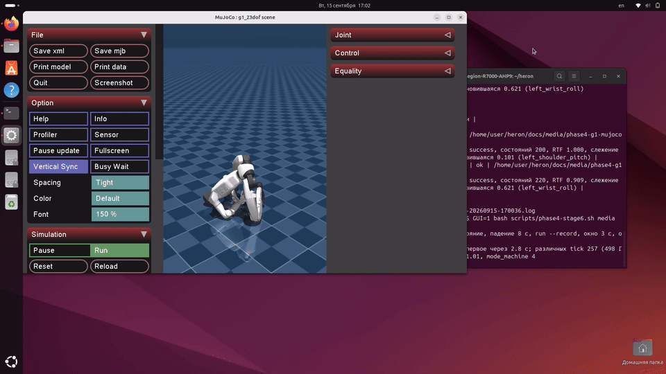
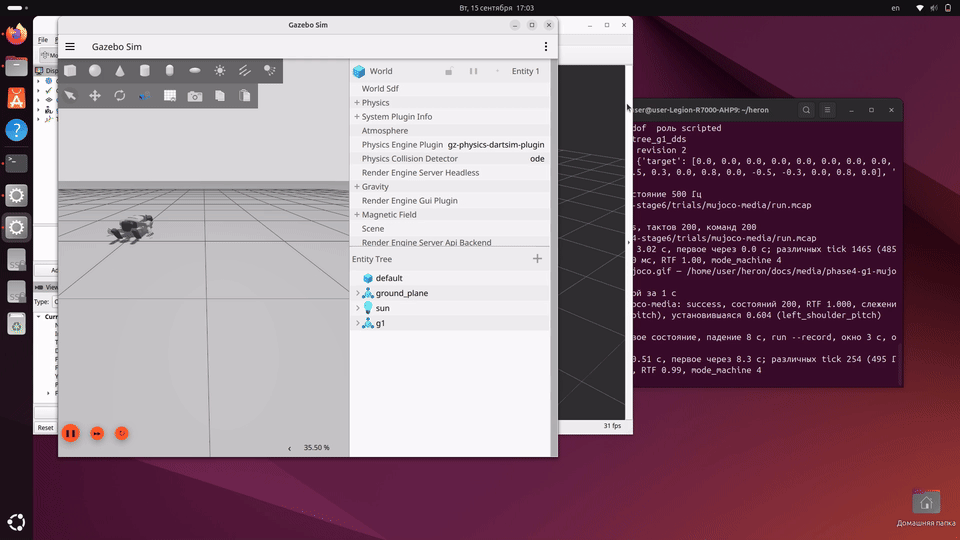
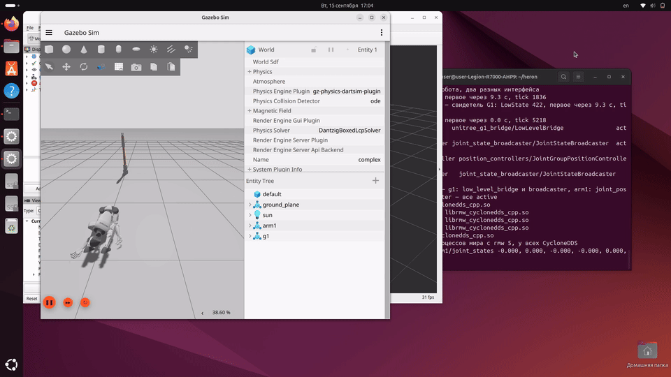

# Heron

Платформа моделирования гетерогенных робототехнических комплексов.

Один декларативный профиль робота → генерация сред → навык кодом или обученная
политика за одним интерфейсом → проверка в симуляции → перенос на железо.

**Новизна — в валидаторе.** Рассогласование сред (порядок суставов, единицы,
частоты, пределы) ловится до запуска, а не проявляется на роботе как поведение
без единой записи в логах. Всё остальное в платформе существует, чтобы этой
проверке было что проверять.

---

## Содержание

Полное руководство — [docs/user-guide.md](docs/user-guide.md): от клонирования до обучения и железа.

- [Состояние](#состояние) · [Установка](#установка) · [Пять минут](#пять-минут)
- [Как это устроено](#как-это-устроено) · [Профиль робота](#профиль-робота)
- [Контракт](#контракт) · [Навыки](#навыки) · [Что ловит валидатор](#что-ловит-валидатор)
- [Среды из профиля](#среды-из-профиля) · [Запуск сцены](#запуск-сцены)
- [Команды](#команды) · [Как добавить своего робота](#как-добавить-своего-робота)
- [Разработка](#разработка) · [Документы](#документы)

---

## Состояние

Фаза 3 закрыта: манипулятор из профиля едет в Gazebo по команде навыка. Цепочка
«профиль → проверка → среда → связь → навык → движение» проходит целиком.

Фаза 4 закрыта: второй робот с принципиально иным интерфейсом. Гуманоид G1
(`examples/robots/g1_23dof`) командуется не позицией, а законом привода в каждой
команде DDS производителя и входит в платформу пакетом «как от производителя»
(`examples/plugins/unitree_g1`): адаптер и двойники, ни строки ядра под него. Один
и тот же DDS-адаптер без изменения кода ведёт G1 навыком `move_joints` в двойнике
MuJoCo производителя и в Gazebo через мост пакета, а связь в профиле записана одна
на оба мира. Сверка двух двойников записана с числами
([эксперимент 0001](docs/experiments/0001-g1-dds-twins.md)), а манипулятор через
`ros2_control` и G1 через DDS работают в одной сцене Gazebo, и их связи не
пересекаются. Итог — [CHANGELOG.md](CHANGELOG.md), `[0.4.0]`.

| G1 в двойнике MuJoCo производителя | G1 в Gazebo через мост пакета | Комплекс: манипулятор и G1 |
|---|---|---|
|  |  |  |

| Фаза | Результат | |
|---|---|---|
| 0 | Окружение поднято, три среды запускаются | скрипт написан, не прогнан |
| 1 | Каркас: модели, протоколы, CLI, `dummy`-адаптер, CI | готово |
| 2 | Манипулятор из профиля появляется в Gazebo и RViz | готово |
| 3 | Навык кодом двигает робота в Gazebo | готово |
| 4 | Второй робот с принципиально иным интерфейсом | готово |
| 5 | Навык кодом на реальном манипуляторе | |
| 6 | Обучение в Isaac → ONNX → тот же навык в Gazebo | |
| 7 | Обученный навык на реальном роботе, метрики sim2real | |
| 8 | Координатор, два робота в одной миссии | |
| 9 | Сравнительные эксперименты, документация | |

Полная дорожная карта — раздел 14 [архитектуры](ARCHITECTURE.md). Что изменилось
по фазам — [CHANGELOG.md](CHANGELOG.md).

### Роботы в примерах

Три класса интерфейса — и ни одного имени робота в ядре:

| Профиль | Как робот командуется | Связь | Где проверен |
|---|---|---|---|
| `arm6` | поток позиций суставов, 50 Гц | `ros2_control` платформы | Gazebo на Linux (фаза 3) |
| `rest_arm` | движение целиком по сетевому API (`control_mode: command`), градусы | адаптер вне ядра (`real`) | валидатором: потоковый навык ему неисполним |
| `g1_23dof` | закон привода в каждой команде: `q*`, `kp`, `kd` в 23 из 29 слотов | DDS производителя, пакет `unitree_g1` | MuJoCo производителя и Gazebo через мост, Linux (фаза 4) |

---

## Установка

```bash
uv venv --python 3.11
uv pip install -e ".[dev]"
```

Ядро ставится **без вендорских зависимостей**: ни симулятора, ни SDK робота, ни
фреймворка обучения в обязательных зависимостях нет. Для профилей, валидатора,
генераторов и CLI окружение фазы 0 не требуется — оно нужно только чтобы
запустить порождённую сцену.

Установка Linux-машины — ROS 2, Gazebo, MuJoCo, Isaac Lab и окружения роботов одной командой
`scripts/install.sh`: [docs/install.md](docs/install.md).

---

## Пять минут

```bash
# что платформа вообще умеет описывать
heron capabilities

# сводка робота: контракт, возможности, адаптеры
heron profile show examples/robots/arm6.yaml

# проверка до запуска
heron validate examples/robots/*.yaml examples/scenarios/table.yaml -R examples/robots

# среды из профиля и сценария
heron gen examples/scenarios/table.yaml --into generated/table -R examples/robots

# что именно будет запущено
heron sim run examples/scenarios/table.yaml --into generated/table -R examples/robots --dry-run
```

Самая показательная команда — вот эта:

```bash
heron skill check hold examples/robots/rest_arm.yaml
```

```
ошибка  [skill.control_mode_incompatible] skill:hold -> profile:rest_arm: навык
требует потокового управления, робот принимает команды целиком
    политика с циклом на фиксированной частоте здесь неисполнима
    решение: раздел 3

итого: ошибок 1, предупреждений 0
```

Навык и робот несовместимы по существу, и это видно до запуска, а не по
странному поведению во время движения.

---

## Как это устроено

```
             профиль робота          сценарий комплекса
            (данные, не код)        (мир, состав, роли)
                  │                        │
                  └───────────┬────────────┘
                              ▼
   описание ───────────► ВАЛИДАТОР ◄─────── контракт политики
   кинематики             сверяет всё,          (ONNX + JSON)
   (вход, URDF)       что описано дважды
                              │
                              ▼
                        ГЕНЕРАТОРЫ
                  порождают только выводимое
                              │
       ┌──────────────────────┼──────────────────────┐
       ▼                      ▼                      ▼
   ros2_control           мир SDF               запуск и RViz
   контроллеры                                  манифест набора
                              │
                              ▼
                   Gazebo · MuJoCo · железо
```

Три правила держат эту схему, и они же объясняют, почему платформа выглядит
именно так.

**Профиль — данные.** Добавление робота не требует правок в ядре: YAML плюс, при
необходимости, плагин-адаптер снаружи. В ядре нет ни одного имени робота — это
проверяется тестом, который удаляет `examples/` и прогоняет остальное.

**Описание кинематики — вход, а не выход.** Звенья, массы и тензоры инерции
достоверны в модели робота, а не в YAML, поэтому платформа их не сочиняет. Зато
профиль и описание — два рассказа об одном роботе, и каждое расхождение между
ними валидатор ловит
([ADR-0009](docs/decisions/0009-generators-do-not-author-kinematics.md)).

**Величина описывается один раз и там, где она достоверна.** Сквозной принцип
всех принятых решений. Прежде чем добавить поле, проверяется, не задано ли оно
уже в `contract` или `limits`.

---

## Профиль робота

```yaml
schema_version: 1
name: arm6

description:
  urdf: urdf/arm6.urdf        # ВХОД: платформа его читает и сверяет, но не пишет

contract:                     # соглашение о представлении данных между средами
  revision: 1
  joint_order: [joint0, joint1, joint2, joint3, joint4, joint5]
  angle_unit: rad
  state_rate_hz: 100
  command_rate_hz: 50
  observation:
    - {type: joint_pos, scale: 1.0}
    - {type: joint_vel, scale: 0.05}
  action:
    type: joint_position
    clip: [-1.0, 1.0]

capabilities: [arm.joint_position, arm.cartesian, gripper.binary]
control_mode: streaming       # streaming — поток команд; command — «выполни движение»

limits:                       # предохранительная рамка: уже модели можно, шире нельзя
  joint_position: {min: [...], max: [...]}
  joint_velocity: {max: [...]}
  cartesian_velocity_max: 0.25

adapters:
  sim.gazebo: {plugin: ros2_control}
  real:       {plugin: my_package.adapter:MyAdapter}
```

Разберём две части подробно: контракт — потому что он сердце платформы, и
навыки — потому что через них платформа вообще что-то делает.

---

## Контракт

**Соглашение о представлении данных между мирами.** Один и тот же робот живёт в
симуляции, в обучении и на железе; в каждом мире его состояние и команды —
просто числа, и смысл этих чисел нигде не записан. Контракт записывает.

Именно его молчаливое расхождение даёт классический отказ: политика обучена там,
где `joint3` был четвёртым в векторе, а запускается там, где он третий — и робот
ведёт себя странно, не оставив ни одной записи в логах. Ошибки нет: обе стороны
работают правильно, каждая со своим представлением.

| Поле | Что фиксирует | Чем оборачивается расхождение |
|---|---|---|
| `joint_order` | какими суставами платформа управляет и **в каком порядке** | команда уходит не в тот сустав |
| `angle_unit` | единицы всех углов | ошибка масштаба в 57 раз |
| `state_rate_hz` | как часто робот отдаёт состояние | политика считает по несвежим данным |
| `command_rate_hz` | как часто принимает команду | поток команд не доходит или переполняет |
| `observation` | состав, порядок и `scale` вектора наблюдения | политика получает шум вместо признаков |
| `action` | тип действия и его границы | момент вместо позиции, отсутствие отсечки |

### Идентичность

У контракта собственная идентичность, не зависящая от версии профиля:

```
contract_id = sha256(каноническая JSON-сериализация нормативных полей)[:16]
```

Нормативны **все** поля контракта, кроме `revision` ([ADR-0006](docs/decisions/0006-contract-canonical-form-and-lock.md)).
Правило простое настолько, что класс `Contract` не содержит ничего лишнего: поле,
не меняющее смысла данных, в контракте и не живёт. Лимиты, например, — не здесь:
они данные ограничивают, а не переопределяют.

Каноническая форма зафиксирована — ключи отсортированы, без пробелов, ASCII,
числа в кратчайшем обратимом виде — и покрыта золотым тестом. Это публичное
поведение ядра, а не деталь реализации: идентификатор, поехавший от обновления
сериализатора, обесценил бы все сохранённые политики разом.

**Совместимость — равенство идентификаторов, и ничего слабее.** Никакой
совместимости «сверху вниз», никаких правил вывода. Либо представление то же,
либо нет.

### Расхождение показывается по полям

```bash
heron contract diff arm6 rest_arm -R examples/robots
```

```
arm6: ef25b68f705cab2f
rest_arm: 6bfde5bd9f9c305b

joint_order: arm6 ['joint0', 'joint1', 'joint2', 'joint3', 'joint4', 'joint5'], rest_arm ['j1', 'j2', 'j3', 'j4']
angle_unit: arm6 'rad', rest_arm 'deg'
observation: arm6 [{'type': 'joint_pos', 'scale': 1.0}, {'type': 'joint_vel', 'scale': 0.05}], rest_arm [{'type': 'joint_pos', 'scale': 1.0}]
action: arm6 {'type': 'joint_position', 'clip': [-1.0, 1.0]}, rest_arm {'type': 'joint_position', 'clip': None}
command_rate_hz: arm6 50.0, rest_arm 2.0
state_rate_hz: arm6 100.0, rest_arm 20.0
```

Факт «хеши разные» бесполезен. Человеку нужно решить, переобучать политику или
править профиль, а для этого нужно видеть, **что именно** разошлось
([ADR-0004](docs/decisions/0004-contract-identity.md)).

### `revision` и lock-файл

`contract_id` вычисляется, `revision` объявляется. Второе — заявление о
намерении: «я знаю, что меняю представление данных».

Чтобы поймать необъявленное изменение, нужно предыдущее состояние — хеш текущего
файла его не даёт. Его хранит `contracts.lock.json` в реестре:

| Идентификатор | `revision` | Что это значит |
|---|---|---|
| не изменился | не изменился | ничего не произошло |
| изменился | изменился | объявленное изменение, принято |
| **изменился** | **не изменился** | молчаливое изменение — ошибка валидатора |

```bash
heron contract id   examples/robots/arm6.yaml
heron contract lock examples/robots/arm6.yaml   # принять текущее состояние
```

Lock-файл пишет **только** команда `contract lock`. Обновляй его валидатор при
проверке, проверка стала бы формальностью: записывала бы ровно то, что только что
увидела. Файл коммитится — это единственная производная величина, которую
платформа версионирует, и она себя оправдывает: изменение представления данных
видно в обзоре изменений отдельной строкой, а не правкой внутри YAML.

### Кто носит контракт

Профиль — не единственный. Контракт сопровождает **каждый артефакт**, который
говорит числами:

- **политика** — ONNX плюс JSON-манифест, в котором лежит и сам контракт, и
  `contract_id`, под которым политика создана. Подделка идентификатора не
  проходит: он вычисляется из приложенного контракта и сверяется
  (`policy.manifest_inconsistent`);
- **траектория** — `.npz` в обучении, MCAP на исполнении, с тем же
  идентификатором ([ADR-0003](docs/decisions/0003-trajectory-format.md)).

Отсюда сквозная проверка: артефакт, созданный под другое представление данных, до
робота не доедет.

Что контракт порождает в средах — [таблица ниже](#среды-из-профиля): тип действия
становится командным интерфейсом, наблюдения — интерфейсами состояния, порядок
суставов — составом контроллера.

---

## Навыки

**Единица поведения.** Навык — это то, через что платформа вообще что-то делает.
Главное свойство: снаружи **код и обученная политика неразличимы**. Миссия
называет навык по имени и не узнаёт, чем он оказался (инвариант 4), поэтому
замена кодового навыка на обученный — одна строка в профиле, а не переписывание
миссии.

### Протокол

```python
class Skill(Protocol):
    required_capabilities: frozenset[Capability]
    required_control_mode: ControlMode

    def start(self, goal: dict, ctx: SkillContext) -> None: ...
    def tick(self, state: RobotState) -> Status: ...   # RUNNING | SUCCESS | FAILURE
    def cancel(self) -> None: ...
```

Цикл простой: `start` принимает цель, `tick` получает состояние и возвращает
статус, команды уходят через контекст. Терминальный статус останавливает навык.

**Цель не интерпретируется ядром.** `goal` передаётся навыку нетронутым: ядро не
знает, что означает `target: random_in_box`, и заводить для этого словарь значило
бы поместить знание о миссии в платформу.

### Объявление

Навык объявляет требования, и это то, что сверяет валидатор:

```python
class HoldSkill(BaseSkill):
    spec = SkillSpec(
        name="hold",
        required_capabilities=frozenset({Capability("arm.joint_position")}),
        required_control_mode=ControlMode.STREAMING,
        requires=Requirements({"dof": ">=1"}),
    )
```

| Что объявляется | Чем является | Как сверяется |
|---|---|---|
| `required_capabilities` | дискретные ключи `<домен>.<аспект>` | равенство множеств, без вывода следствий |
| `required_control_mode` | `streaming` или `command` | поток команд на командном роботе неисполним |
| `requires` | количественные пороги | сравнение с `contract` и `limits` профиля |

Разделение дискретного и количественного — решение
[ADR-0001](docs/decisions/0001-capability-format.md). Возможность говорит, **что
за** управление робот предлагает, и никогда — **сколько**. Величины живут в
контракте и лимитах, а навык объявляет пороги против них:

```yaml
requires: {dof: ">=6", command_rate_hz: ">=50", gripper_width_m: ">=0.06"}
```

Язык — три сравнения `>=`, `<=`, `==`, и расширять его до выражений запрещено:
как только внутри появляется логика, это код внутри данных. Имена величин —
закрытый реестр, у каждой ровно один источник в профиле
([ADR-0008](docs/decisions/0008-requires-registry.md)). Величина, которой профиль
не объявляет, считается **невыполненным** требованием, а не пропущенной
проверкой: «не знаю» и «подходит» не должны выглядеть одинаково.

### Две сверки, а не одна

```bash
heron skill check hold examples/robots/arm6.yaml      # замечаний нет
heron skill check hold examples/robots/rest_arm.yaml  # skill.control_mode_incompatible
```

Перед первым тиком проверяется не одно, а два утверждения, и они законно
расходятся:

- **профиль** говорит, что робот собой представляет → коды `skill.*`;
- **адаптер** говорит, что умеет именно эта связь → коды `adapter.*`.

Симуляционный двойник беднее живой машины, и знание о том, что может связь,
принадлежит адаптеру, а не ядру. Поэтому навык, исполнимый по профилю, всё ещё
может быть отклонён на конкретном соединении.

### Библиотека

Имя → реализация. Встроенные навыки и сторонние приходят одной и той же точкой
входа Python; библиотека возвращает фабрику и объявление, но никогда — намёк на
то, код это или политика.

```bash
heron skill list
```

```toml
[project.entry-points."heron.skills"]
my_skill = "my_package.skills:MySkill"
```

### Навык, который двигает

`move_joints` ведёт суставы к объявленной позе по временно́му разгону:

```bash
heron sim run examples/scenarios/table.yaml --into generated/table   # терминал 1
heron run examples/scenarios/table.yaml                              # терминал 2
```

Две команды, а не одна, потому что мир и контейнер робота — разные единицы
развёртывания (раздел 4): любую из них можно перезапустить, не трогая другую.

Разгон делает навык, а не адаптер. Групповой контроллер позиций передаёт то, что
получил, прямо в интерфейс сустава, поэтому одна команда в цель означает «окажись
там немедленно» — симулятор подчинится единственным доступным ему способом, и
движение будет определяться не целью, а коэффициентами регулятора.

Что будет опубликовано, видно до публикации:

```bash
heron run examples/scenarios/table.yaml --dry-run
```

```
сцена     table  (владелец физики gazebo)
робот     arm1  профиль arm6  роль scripted
связь     sim.gazebo -> ros2_control
контракт  ef25b68f705cab2f  revision 1
навык     move_joints  цель {'target': [...], 'duration': 4.0}
темп      команды 50 Гц, состояние 100 Гц
состояние /arm1/joint_states  (sensor_msgs/msg/JointState)
команды   /arm1/joint_position_controller/commands  (std_msgs/msg/Float64MultiArray)
```

Эти же имена лежат в `manifest.json` порождённого набора — их пишет генератор,
их читает адаптер, и выводятся они в одном месте (ADR-0014). Сверить с
`ros2 topic list` можно одной строкой.

### Темп и сторожевой таймер

Цикл идёт с частотой `command_rate_hz`, и период считается от начала такта:
время на чтение состояния входит в период, а не прибавляется к нему. Если
состояние перестало приходить дольше, чем на десять периодов `state_rate_hz`
(но не менее полусекунды), робот останавливается, и только потом сообщается
отказ. Ни та, ни другая величина в профиле не объявляется — обе уже есть в
контракте (ADR-0015).

### Чего ещё нет

`LearnedSkill` — единственная реализация `Skill` в ядре по разделу 5 — не
написана, и это осознанно. Настоящего артефакта ONNX не существует до фазы 6, а
писать проверку контракта вокруг пустоты значит писать код, который придётся
переписать, когда появится настоящий экспортёр. Сверка манифеста политики с
профилем при этом **уже работает**: она доказывает ровно то, что нужно доказать
на этом этапе.

Запись прогона появилась в фазе 4: `run --record <файл>` по ходу прогона пишет в
MCAP каждое прочитанное состояние и каждую принятую адаптером команду — со временем
мира и часами исполнителя, с контрактом до первого такта и итогом в конце
([ADR-0038](docs/decisions/0038-the-executor-records-the-run.md)). Её открывает
Foxglove. Воспроизведения по ней — роли `replay` — ещё нет.

---

## Что ловит валидатор

52 кода. У каждой находки устойчивый код `<область>.<правило>`, severity,
подсказка и ссылка на решение; коды — публичный API, тесты проверяют их, а не
формулировки ([ADR-0007](docs/decisions/0007-validator-findings.md)). Помеченные
«предупреждение» запуск не останавливают.

**Контракт и профиль**

| Код | Когда |
|---|---|
| `contract.undeclared_change` | представление данных изменилось, `revision` — нет |
| `contract.field_mismatch` | контракты расходятся; печатается различие по полям |
| `contract.identity_mismatch` | идентификаторы контрактов различаются |
| `contract.command_faster_than_state` | команды чаще состояния (предупреждение) |
| `contract.command_rate_suspicious` | режим `command` при высокой частоте команд (предупреждение) |
| `contract.observation_duplicate` | терм наблюдения повторяется (предупреждение) |
| `limits.length_mismatch` | лимитов не столько, сколько суставов в `joint_order` |
| `profile.image_has_namespace` | в профиле записано пространство имён образа |
| `adapter.plugin_not_installed` | плагин адаптера на этой машине не установлен (предупреждение) |

**Описание кинематики против профиля** — URDF (фаза 2) и MJCF (фаза 4, [ADR-0031](docs/decisions/0031-mjcf-is-a-second-description.md))

| Код | Когда |
|---|---|
| `urdf.file_not_found`, `mjcf.file_not_found` | описания нет по указанному пути |
| `urdf.unreadable`, `mjcf.unreadable` | описание не разбирается |
| `urdf.not_rendered` | описание — шаблон `.xacro`, сверка не выполнялась (предупреждение) |
| `urdf.no_root_link` | нет единственного корневого звена |
| `urdf.name_differs` | описание называет робота иначе, чем профиль (предупреждение) |
| `urdf.joint_missing`, `mjcf.joint_missing` | сустав контракта отсутствует в модели или переименован в ней |
| `urdf.joint_not_commandable`, `mjcf.joint_not_commandable` | контракт собирается командовать суставом, которым модель командовать не даёт |
| `mjcf.joint_not_actuated` | у сустава контракта в модели MuJoCo нет привода |
| `urdf.position_limit_wider`, `mjcf.position_limit_wider` | профиль разрешает больше, чем физически может модель |
| `urdf.velocity_limit_wider` | то же по скорости |
| `urdf.joint_not_in_contract` | подвижный сустав модели платформе неизвестен (предупреждение) |
| `urdf.mesh_not_found`, `mjcf.mesh_not_found` | модель ссылается на меш, которого нет |
| `urdf.mesh_unresolvable` | ссылку на меш разрешает только ROS 2 или симулятор (предупреждение) |
| `urdf.free_base_uncontrolled` | база свободна, а встроенный контроллер отключён — условие прогона (предупреждение, [ADR-0018](docs/decisions/0018-free-base-is-a-run-condition.md)) |
| `mjcf.differs_from_urdf` | два описания робота расходятся в пределах; печатаются оба числа (предупреждение) |

Сравнение идёт **с переводом единиц**: URDF по спецификации в радианах, а
контракт может объявлять градусы. Без перевода валидатор кричал бы на исправном
роботе, а это хуже отсутствующей проверки — приучает её пропускать.

**Навык, политика, сцена, двойник**

| Код | Когда |
|---|---|
| `skill.undeclared` | у навыка нет объявления, совместимость не проверить |
| `skill.control_mode_incompatible` | навык требует потока команд, робот принимает движение целиком |
| `skill.capabilities_missing` | робот не объявляет требуемой возможности |
| `skill.requirement_unmet` | не выполнено количественное требование из блока `requires` |
| `adapter.capabilities_missing`, `adapter.control_mode_incompatible` | то же, но связь предлагает меньше, чем профиль |
| `policy.manifest_inconsistent` | записанный в артефакте `contract_id` не отвечает приложенному контракту |
| `policy.capabilities_missing` | робот не объявляет возможности, которой ждёт политика |
| `scenario.profile_not_found` | сцена называет профиль, которого нет в реестре |
| `scenario.backend_adapter_missing` | у робота нет адаптера под владельца физики сцены |
| `scenario.multiple_learners` | ролей `learner` больше одной |
| `scenario.replay_trajectory_unchecked` | траектория роли `replay` не проверена (предупреждение) |
| `twin.missing` | у адаптера нет двойника под бэкенд сцены — в мире некому говорить протоколом робота ([ADR-0021](docs/decisions/0021-robot-ships-as-adapter-and-twin.md)) |
| `twin.unloadable` | двойник установлен, но не загружается |
| `twin.owns_physics_not_alone` | двойник сам владеет физикой, а участников в сцене больше одного |
| `mjcf.scene_missing` | мир MuJoCo не называет сцену |
| `mjcf.scene_without_description` | сцена MuJoCo не загружает описание профиля |
| `mjcf.timestep_slower_than_state` | шаг физики сцены медленнее, чем контракт обещает состояние |

**Окружение машины** — `env check`, `sim run`, `run` ([ADR-0025](docs/decisions/0025-environment-requirements.md)); `validate` окружения не касается

| Код | Когда |
|---|---|
| `env.missing` | нужного стороне связи нет на этой машине |
| `env.version_unmet` | нужное есть, но не той версии |
| `env.forbidden` | на машине есть запрещённое, например CycloneDDS 0.11+ рядом с 0.10.2 |
| `env.unreadable` | требования стороны связи не прочитать |

Коды возврата CLI: `0` — чисто, `1` — найдены ошибки, `2` — вход не читается.

---

## Среды из профиля

```bash
heron gen examples/scenarios/table.yaml --into generated/table -R examples/robots
heron gen examples/scenarios/table.yaml --into generated/table -R examples/robots --check
```

Порождается только то, что выводимо из профиля и сценария:

| Файл | Из чего выведен |
|---|---|
| `<робот>/description.urdf` | входное описание плюс блок `ros2_control` из контракта |
| `<робот>/controllers.yaml` | тип действия, режим управления, `state_rate_hz`, `joint_order` |
| `world.sdf` | сценарий; шаг физики — из наибольшей частоты состояния |
| `bringup.launch.xml` | состав сценария, позы, идентификаторы роботов |
| `view.rviz` | корневые звенья описаний и префиксы систем отсчёта |
| `manifest.json` | чем порождено, из чего и при каком `contract_id` |

Контракт превращается в интерфейсы управления почти буквально:

| Контракт | Стек управления |
|---|---|
| `action.type` | командный интерфейс (`position`, `velocity`, `effort`) |
| `observation` | интерфейсы состояния — и ничего сверх объявленного |
| `joint_order` | состав и порядок суставов контроллера |
| `state_rate_hz` | частота `controller_manager` и шаг физики мира |
| `control_mode` | класс контроллера: групповой или траекторный |
| `limits` | границы командного интерфейса |

**Что генератор не пишет никогда.** Описание кинематики и заданный сценарием
`world.file` — вход: они не перезаписываются. Действие, у которого нет интерфейса
сустава (декартова поза, ширина захвата), генератор отклоняет, а не приближает:
робот, который двигается и при этом неправ, — ровно тот отказ, ради которого
платформа написана.

**Генерация детерминирована** — тот же вход даёт побайтово тот же выход. Отсюда
`--check`: «артефакты отстали от профиля» становится проверяемым фактом, а не
догадкой по времени изменения файлов. Проверка не требует ни симулятора, ни
ROS 2, поэтому стоит в CI. Выходной каталог не версионируется: производную
величину рядом с исходной не хранят
([ADR-0010](docs/decisions/0010-generated-artifacts.md)).

---

## Запуск сцены

```bash
heron sim run examples/scenarios/table.yaml --into generated/table -R examples/robots --dry-run
heron sim run examples/scenarios/table.yaml --into generated/table -R examples/robots
```

`--dry-run` печатает команды и не запускает ничего — это работает где угодно.
Настоящий запуск требует Linux с ROS 2 Jazzy и Gazebo Harmonic, то есть
[окружения из docs/install.md](docs/install.md).

Бэкенд симуляции — оркестратор процессов, а не ссылка на тела сцены: ядро
ставится без вендорских зависимостей, поэтому оно говорит с симулятором
командными строками. Процессы запускаются через внедряемый запускатель, и потому
состав запуска проверяем **до** запуска
([ADR-0011](docs/decisions/0011-sim-backend-runs-processes.md)).

Сцену, не прошедшую валидатор, бэкенд не строит вовсе. Мир, который не удаётся
запустить, лучше мира, который запускается неправильно.

> **Честная граница.** Ни одна порождённая сцена пока не запускалась. Тесты
> доказывают состав команд и ничего не говорят о том, что Gazebo от них
> поднимется. Это записано в карточку решения, а не только сюда.

---

## Команды

| Команда | Что делает |
|---|---|
| `heron version` | версия и пути, по которым платформа ищет данные |
| `heron capabilities` | реестр возможностей ядра |
| `heron validate <файлы>` | проверка профилей и сценариев до запуска |
| `heron profile list \| show \| new` | реестр профилей, сводка робота, заготовка нового |
| `heron contract id \| diff \| lock` | идентичность контракта, различие по полям, фиксация |
| `heron skill list \| check` | библиотека навыков и совместимость навыка с роботом |
| `heron gen <файлы> --into <кат>` | порождение сред; `--check` — сверка с тем, что лежит |
| `heron sim run <сценарий> --into <кат>` | сборка мира и запуск сцены; `--dry-run`, `--headless`, `--no-rviz` |
| `heron run <сценарий>` | задача на роботе поднятого мира, в окружении этого мира; `--robot`, `--skill`, `--goal`, `--record`, `--dry-run` |
| `heron env check <сценарий>` | хватит ли этой машине окружения для двойников и адаптеров сцены |

Реестр профилей задаётся повторяемым `--registry` (`-R`) и переменной
`HERON_REGISTRY`.

---

## Как добавить своего робота

```bash
heron profile new my_robot --into examples/robots
```

Создаётся три файла и ни одной правки в ядре:

```
my_robot/
├── profile.yaml            # данные: контракт, возможности, лимиты, адаптеры
├── adapter.py              # скелет ControlAdapter со всеми методами протокола
└── urdf/my_robot.urdf      # скелет описания — дальше это ваш входной файл
```

Заполняете TODO, проверяете валидатором, порождаете среды:

```bash
heron validate examples/robots/my_robot/profile.yaml
heron gen      examples/robots/my_robot/profile.yaml --into generated/my_robot --backend gazebo
```

**Подробный разбор — [docs/adding-a-robot.md](docs/adding-a-robot.md):** откуда
взять описание кинематики, что делать, если есть только CAD-модель, какие
требования к URDF, что означает каждое поле профиля и что валидатор скажет, если
профиль и модель разошлись.

Расширение идёт только через пять точек — четыре протокола `ControlAdapter`,
`Skill`, `SimBackend`, `TrainBackend` и сторону двойника
([ADR-0021](docs/decisions/0021-robot-ships-as-adapter-and-twin.md)), — и
подключается штатными точками входа Python:

```toml
[project.entry-points."heron.adapters"]
my_robot = "my_package.adapter:MyAdapter"
```

У ядра нет частного пути для собственных плагинов: встроенный `dummy`-адаптер и
бэкенд Gazebo регистрируются теми же точками входа.

Если у робота свой протокол и свой симулятор от производителя, адаптер и двойник
приходят одним пакетом —
[раздел руководства](docs/adding-a-robot.md#если-производитель-дал-адаптер-и-двойник),
живой пример — `examples/plugins/unitree_g1`.

---

## Разработка

```bash
pytest                    # 490 тестов платформы
pytest examples/plugins/unitree_g1/tests   # 86 тестов пакета G1
ruff check src tests
mypy                      # строгий режим
```

CI гоняет три задачи: проверки; инвариант 1 — ядро без `examples/`; установка
ядра без вендорских зависимостей с порождением сред и сверкой `--check`.

Отдельно проверяются инварианты, которые иначе держались бы на дисциплине:

```bash
pytest tests/test_invariants.py
```

Ядро не знает имён роботов; имя платформы не встречается литералом нигде, кроме
`core/branding.py`; заготовка робота не трогает ни одного файла ядра.

---

## Документы

| Документ | О чём |
|---|---|
| [docs/user-guide.md](docs/user-guide.md) | **руководство пользователя**: установка, устройство, файлы, все команды, рецепты, частые проблемы |
| [ARCHITECTURE.md](ARCHITECTURE.md) | источник правды: инварианты, абстракции, дорожная карта |
| [docs/decisions/](docs/decisions/) | почему сделано так: контекст, решение, отвергнутые альтернативы |
| [docs/journal/](docs/journal/) | ход работы, включая тупики и отрицательные результаты |
| [docs/adding-a-robot.md](docs/adding-a-robot.md) | как добавить своего робота: от CAD до сцены |
| [docs/install.md](docs/install.md) | установка Linux-машины: ROS 2, Gazebo, MuJoCo, Isaac Lab, окружения роботов |
| [scripts/README.md](scripts/README.md) | что лежит в scripts/: установщик, инструменты, прогоны на Linux |
| [CHANGELOG.md](CHANGELOG.md) | что изменилось для пользователя по фазам |

Имя `heron` — рабочее. Правила раздела 17 архитектуры держат переименование в
пределах механической операции: единственная точка правды — `core/branding.py`.

## Лицензия

MIT.
